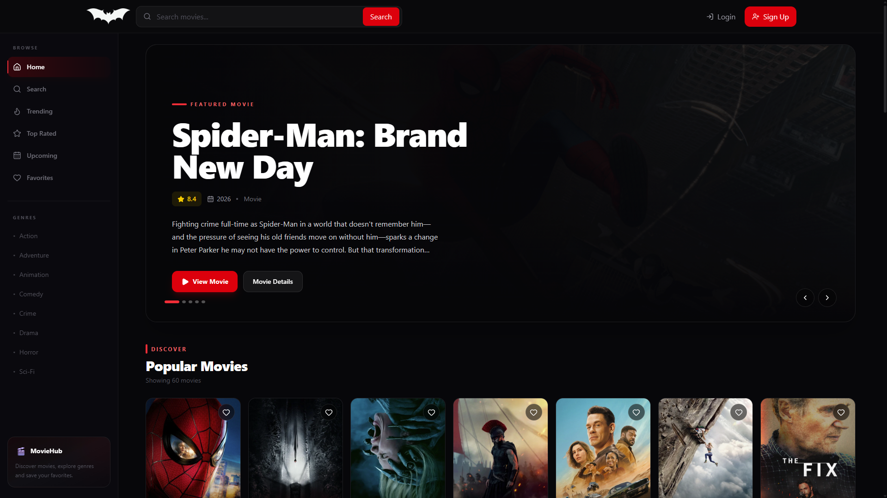
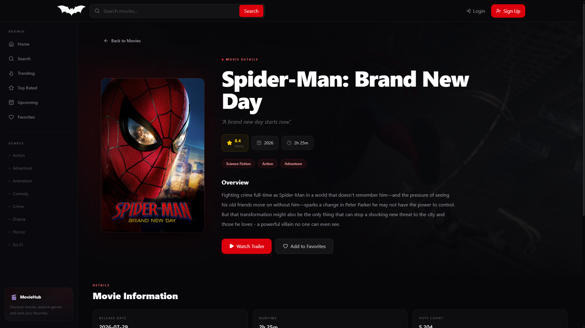

# 🎬 MovieHub — Discover Your Next Favorite Movie

MovieHub is a modern movie discovery web application built with React, TypeScript, and the TMDB API. Explore popular movies, discover trending titles, search for movies, and browse detailed movie information through a clean, cinematic interface.

🔗 **Live Demo:** https://movie-app-six-hazel.vercel.app/
📂 **GitHub Repository:** https://github.com/tausifahamedsabab/movie-app

---

## ✨ Features

- 🎥 **Discover Movies** — Browse popular and trending movies.
- 🔍 **Movie Search** — Search for movies by title.
- 📄 **Movie Details** — Explore movie information, ratings, and overviews.
- 🏆 **Top-Rated Movies** — Discover highly rated movies.
- 🎭 **Genre Exploration** — Browse movies by genre.
- ❤️ **Favorites** — Keep track of favorite movies, if enabled in the current build.
- 📱 **Responsive Design** — Enjoy the interface across different screen sizes.
- ⚡ **Dynamic API Integration** — Fetch movie data using the TMDB API.

## 🛠️ Tech Stack

| Technology   | Purpose                                 |
| ------------ | --------------------------------------- |
| React        | Building reusable UI components         |
| TypeScript   | Type-safe development                   |
| Vite         | Development server and build tooling    |
| Tailwind CSS | Styling and responsive layouts          |
| React Router | Client-side navigation                  |
| TMDB API     | Movie data and information              |
| Git & GitHub | Version control and source code hosting |

## 📸 Screenshots

### Home Page 

### Movie Details 

### Home Page

## 🚀 Getting Started

Follow these steps to run MovieHub locally.

### Prerequisites

- Node.js installed
- npm installed
- A TMDB API key

### 1. Clone the Repository

```bash
git clone https://github.com/tausifahamedsabab/movie-app.git
```

### 2. Navigate to the Project Directory

```bash
cd movie-app
```

### 3. Install Dependencies

```bash
npm install
```

### 4. Configure Environment Variables

Create a `.env` file in the project root and add your TMDB API key:

```env
VITE_TMDB_API_KEY=your_tmdb_api_key
```

Replace `your_tmdb_api_key` with your own API key.

**Important:** Never commit your real `.env` file to GitHub. Keep it in `.gitignore`. Vite variables prefixed with `VITE_` are exposed to client-side code, so use only an appropriate public API key and follow the API provider's security guidance.

### 5. Start the Development Server

```bash
npm run dev
```

Open the local URL shown in your terminal to view the application.

### 6. Build for Production

```bash
npm run build
```

To preview the production build locally:

```bash
npm run preview
```

## 🔑 API Reference

MovieHub uses the [TMDB API](https://developer.themoviedb.org/docs) to retrieve movie information, posters, ratings, and other available metadata.

To use the API, create an account with [The Movie Database](https://www.themoviedb.org/) and obtain an API key.

## 🌐 Deployment

This project can be deployed using [Vercel](https://vercel.com/).

1. Import the GitHub repository into Vercel.
2. Set the `VITE_TMDB_API_KEY` environment variable.
3. Deploy the project.
4. Add the resulting live URL to this README.

## 📚 What I Learned

Through this project, I practiced:

- Building reusable components with React.
- Using TypeScript in a frontend application.
- Fetching and displaying external API data.
- Managing routes and dynamic movie pages.
- Creating responsive layouts with Tailwind CSS.
- Managing source code with Git and GitHub.
- Preparing a frontend application for deployment.

## ⚠️ Disclaimer

MovieHub is an educational project created for learning and demonstration purposes. Movie information and images are provided by TMDB. This project is not endorsed or certified by TMDB.

This product uses the TMDB API but is not endorsed or certified by TMDB.

## 👨‍💻 Author

**Tausif Ahmed Sabab**

- GitHub: [@tausifahamedsabab](https://github.com/tausifahamedsabab)
- LinkedIn: [Tausif Ahmed Sabab](https://www.linkedin.com/in/tausif-ahamed-sabab/)

---

⭐ If you find this project interesting, feel free to explore the repository!
